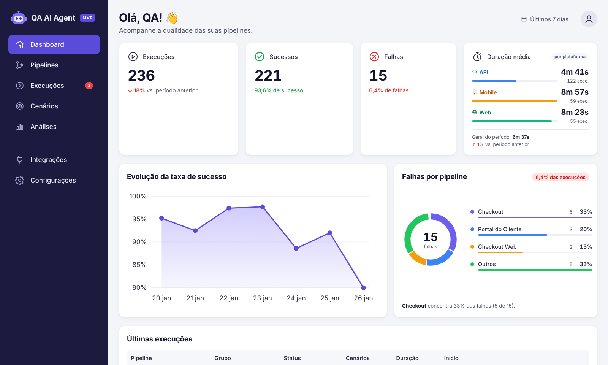

# QA AI Agent

> 🇧🇷 [Leia em português](README.pt-BR.md)

**All your test results on a single screen.** QA AI Agent is a web portal to follow the quality of automated test pipelines. It brings runs, scenarios, analytics and **real-time** tracking from Jenkins, GitHub Actions and Jira together, with an **AI agent** interface to ask about failures. In this MVP version the agent's answers use sample data; connecting it to a real model (OpenAI, Anthropic or Azure) is on the roadmap.

> **Live demo:** https://david-nascimento.github.io/qa-ai-agent-demo/
> The demo runs entirely in the browser with sample data: no server and no real integrations. It opens in English or Portuguese depending on your browser language, and there is a PT | EN switch in the corner. Tip: open **Runs › Live** and wait about 10 seconds to watch pipelines running.

> **This repository is a showcase.** The portal and server source code is private. See the [license](LICENSE).

---

## What the portal does

| Screen | What it is for |
|---|---|
| **Dashboard** | Summary of the last 7 days, with an AI agent panel |
| **Pipelines** | Projects and components, with counts per folder |
| **Runs** | History and **live** tracking |
| **Scenarios** | Jira and Zephyr scenarios with the latest result |
| **Analytics** | Quality, execution time and stability |
| **QA Agent** | Analysis and recommendations chat (MVP: sample answers) |
| **Integrations & Permissions** | Connections and per-person, per-project access |

## Screens

### Pipelines

### Live runs

### Jira and Zephyr scenarios

### Analytics

### QA Agent

### Permissions per person and project

## Under the hood

- **Real time** through Server-Sent Events: events arrive without reloading the page.
- **REST API integrations** with Jenkins, GitHub Actions and Jira/Zephyr.
- **Per-person access**: each person has their own key, shown only once; only its hash is stored. Roles and projects limit what each person sees.
- **Security**: mandatory HTTPS, secrets encrypted with AES-GCM and an audit log.
- **Zero dependencies** on the Node server, and a plain JavaScript front-end.
- **SQLite history**, with an alternative Elixir backend in development.
- **Functional map** with 137 documented business rules.

## Roadmap

- [ ] AI agent connected to a real model (OpenAI, Anthropic or Azure).
- [ ] Elixir backend: foundation and contract tests are ready; Jenkins, GitHub and Jira still need to be ported.
- [ ] SSO login.
- [ ] My cards: each person sees their own items first.
- [ ] Email, Slack or Teams alerts when a pipeline fails.
- [ ] Readers for GitLab CI and Azure DevOps.

## Contact

Built by [David Nascimento](https://github.com/David-Nascimento).
