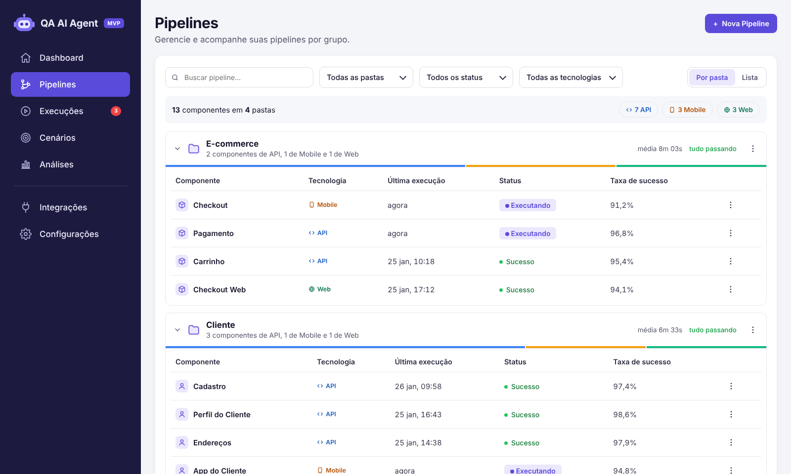
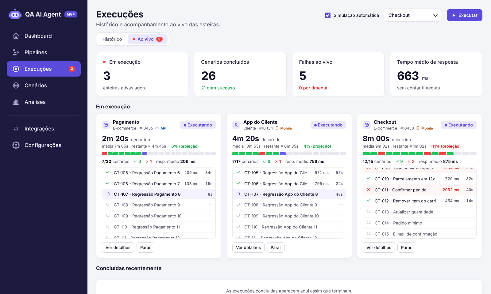
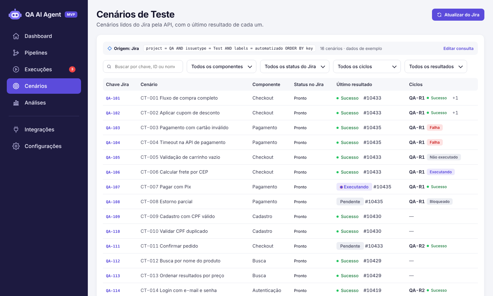
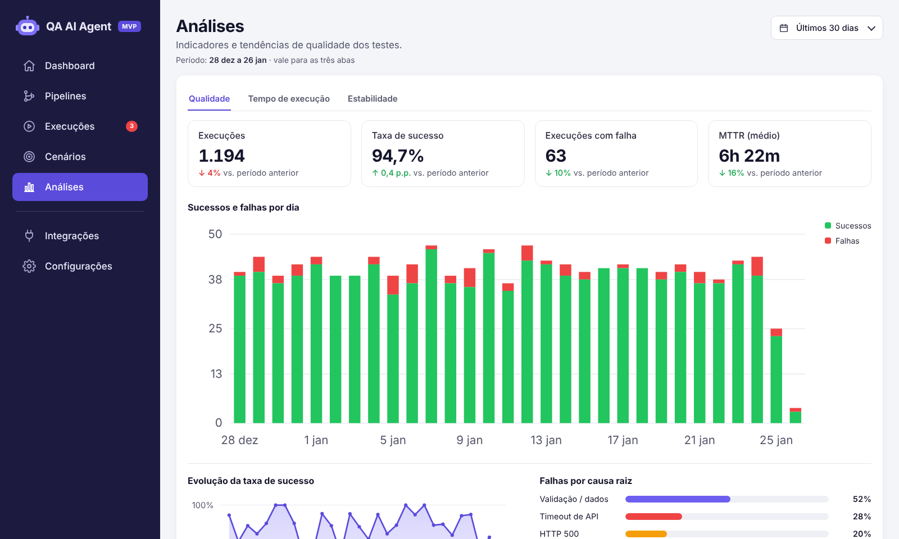
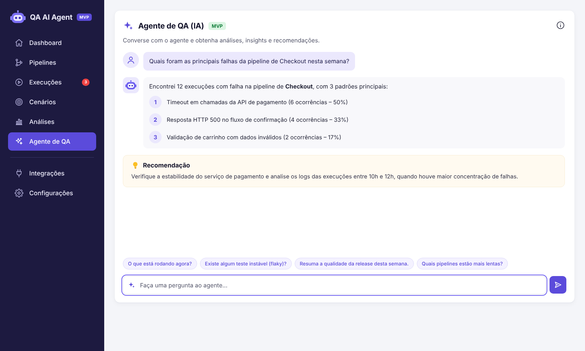
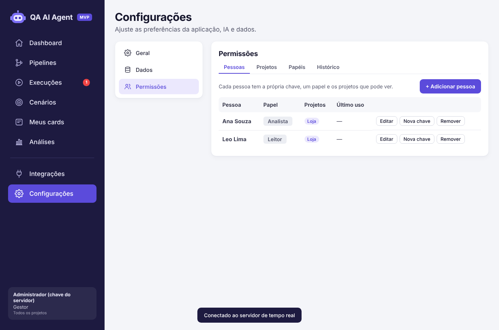

# QA AI Agent

**Todos os seus testes em uma única tela.** O QA AI Agent é um portal para acompanhar a qualidade das pipelines de teste automatizado. Ele reúne execuções, cenários, análises e acompanhamento **em tempo real** de Jenkins, GitHub Actions e Jira, com uma interface de **agente de IA** para perguntar sobre falhas. Nesta versão MVP as respostas do agente usam dados de exemplo; a ligação a um modelo real (OpenAI, Anthropic ou Azure) está no roadmap.

> **Veja a demonstração online:** `https://david-nascimento.github.io/qa-ai-agent-demo/`
> A demonstração usa dados de exemplo e roda só no navegador, sem servidor e sem integrações reais.

> **Este repositório é uma vitrine.** O código do portal e do servidor é privado. Veja a [licença](LICENSE).

---

## O que o portal faz

| Tela | Para que serve |
|---|---|
| **Dashboard** | Resumo dos últimos 7 dias, com painel do agente de IA |
| **Pipelines** | Projetos e componentes, com a contagem por pasta |
| **Execuções** | Histórico e acompanhamento **ao vivo** |
| **Cenários** | Cenários do Jira e do Zephyr com o último resultado |
| **Análises** | Qualidade, tempo de execução e estabilidade |
| **Agente de QA** | Chat de análises e recomendações (MVP: respostas de exemplo) |
| **Integrações e Permissões** | Conexões e acesso por pessoa e projeto |

## Telas

### Pipelines

### Execuções ao vivo

### Cenários do Jira e do Zephyr

### Análises

### Agente de QA

### Permissões por pessoa e projeto

## Por dentro

- **Tempo real** por Server-Sent Events: os eventos chegam sem recarregar a página.
- **Integrações por API REST** com Jenkins, GitHub Actions e Jira/Zephyr.
- **Acesso por pessoa**: cada pessoa tem a sua chave, que aparece uma única vez; só o hash é guardado. Papéis e projetos limitam o que cada um enxerga.
- **Segurança**: HTTPS obrigatório, segredos cifrados com AES-GCM e registro de auditoria.
- **Zero dependências** no servidor Node e interface em JavaScript puro.
- **Histórico em SQLite**, com backend alternativo em Elixir em desenvolvimento.
- **Mapa de funcionalidades** com 137 regras de negócio documentadas.

## Roadmap

- [ ] Agente de IA ligado a um modelo real (OpenAI, Anthropic ou Azure).
- [ ] Backend em Elixir: base e contrato de testes prontos; falta portar Jenkins, GitHub e Jira.
- [ ] Login com SSO.
- [ ] Meus cards: cada pessoa vê primeiro o que é dela.
- [ ] Alertas por e-mail, Slack ou Teams quando uma esteira falhar.
- [ ] Leitores para GitLab CI e Azure DevOps.

## Contato

Feito por [David Nascimento](https://github.com/David-Nascimento). Para conversar sobre o projeto, abra uma conversa pelo LinkedIn ou deixe um comentário na publicação.
